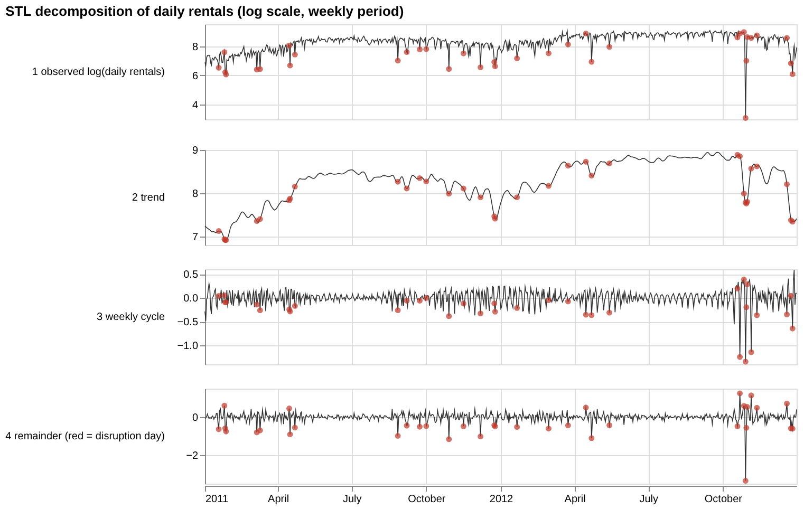
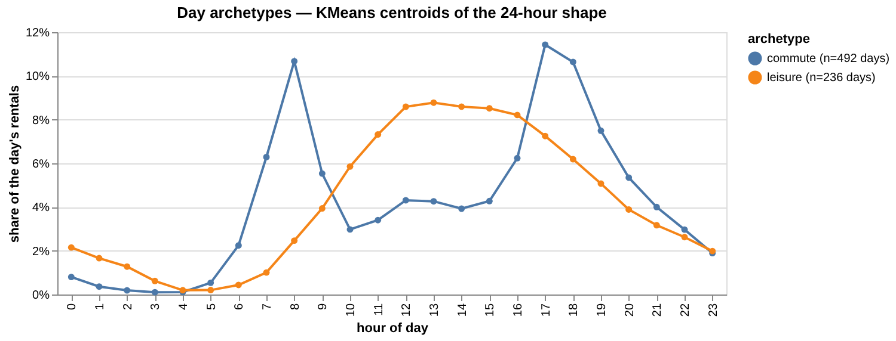
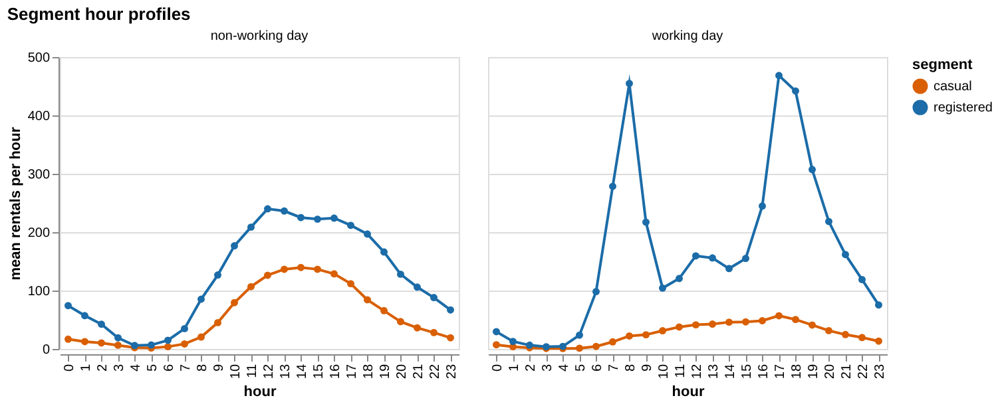
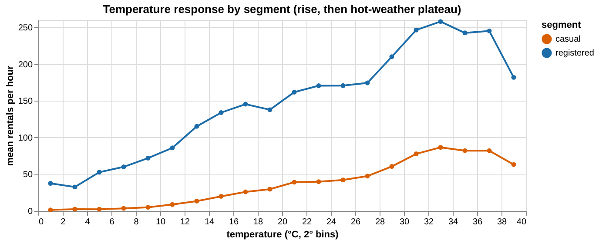
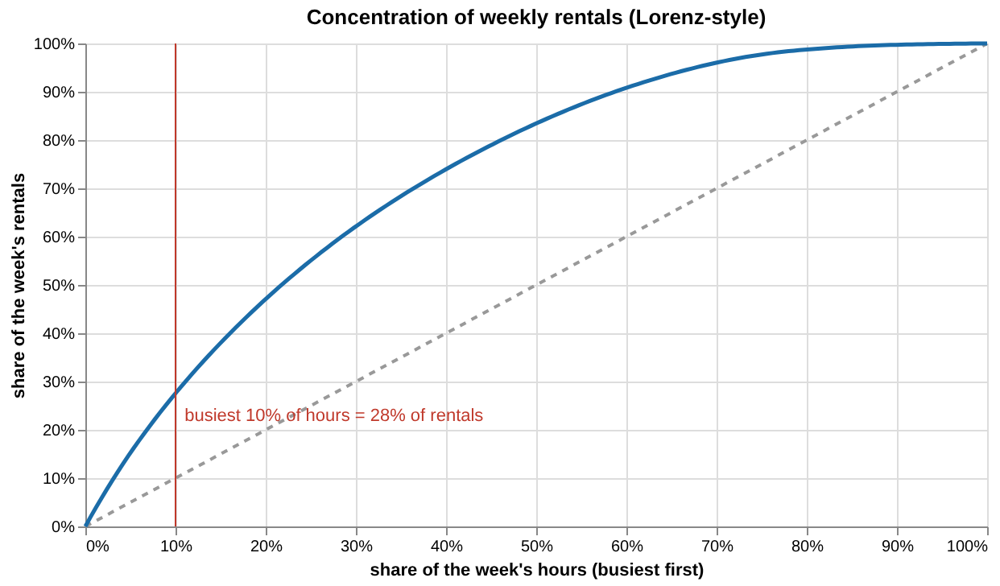

# Data audit — Workstream 1

*Generated by `bikeops.reporting.write_data_audit` from `artifacts/tables/` on 2026-11-04.*

## 1. Profile facts (Part 2 of the blueprint)
All 20 facts reproduced (20/20). Source: `artifacts/tables/profile_facts.csv`.

| fact                                         | expected               | observed               | reproduced   |
|:---------------------------------------------|:-----------------------|:-----------------------|:-------------|
| hour.csv rows                                | 17379                  | 17379                  | True         |
| hour.csv columns                             | 17                     | 17                     | True         |
| day.csv rows                                 | 731                    | 731                    | True         |
| day.csv columns                              | 16                     | 16                     | True         |
| possible hours (731 x 24)                    | 17544                  | 17544                  | True         |
| hours absent from hour.csv                   | 165                    | 165                    | True         |
| null cells (hour.csv)                        | 0                      | 0                      | True         |
| duplicate rows (hour.csv)                    | 0                      | 0                      | True         |
| rows where casual + registered != cnt        | 0                      | 0                      | True         |
| days where hourly sums != day.csv            | 0                      | 0                      | True         |
| windspeed = 0 rows                           | 2180                   | 2180                   | True         |
| hum = 0 rows                                 | 22                     | 22                     | True         |
| weathersit = 4 rows                          | 3                      | 3                      | True         |
| season 1 months (Jan-mid Mar, plus late Dec) | [1, 2, 3, 12]          | [1, 2, 3, 12]          | True         |
| season 1 last March day                      | 2011/2012-03-20        | 2011/2012-03-20        | True         |
| corr(temp, atemp) ~ 0.99                     | 0.99                   | 0.99                   | True         |
| rentals 2011                                 | 1243103                | 1243103                | True         |
| rentals 2012                                 | 2049576                | 2049576                | True         |
| peak hour                                    | 2012-09-12 18:00 = 977 | 2012-09-12 18:00 = 977 | True         |
| lowest day                                   | 2012-10-29 = 22        | 2012-10-29 = 22        | True         |

## 2. Data contract
`bikeops/contract.py` encodes the Readme as a pandera schema: ranges and categories for every column, the identity
casual + registered = cnt, one row per (dteday, hr), and yr / mnth / weekday / workingday agreement with the calendar.
Running it on the raw file fails — as expected — only on the sentinel zeros (2202 failure cases;
`artifacts/tables/contract_violations.csv`). The repaired table passes the stricter repaired contract (weathersit in 1-3, hum > 0,
windspeed > 0) with zero failures.

| column    | check           |   n_failures |
|:----------|:----------------|-------------:|
| hum       | greater_than(0) |           22 |
| windspeed | greater_than(0) |         2180 |

## 3. Audit: check → finding → action → impact

| Check           | Method                                    | Finding                                                                                                                                                                                                                                                                                                                                                                                                                                                | Action                                                                                                               | Impact                                                                                            |
|:----------------|:------------------------------------------|:-------------------------------------------------------------------------------------------------------------------------------------------------------------------------------------------------------------------------------------------------------------------------------------------------------------------------------------------------------------------------------------------------------------------------------------------------------|:---------------------------------------------------------------------------------------------------------------------|:--------------------------------------------------------------------------------------------------|
| Calendar gaps   | Anti-join vs 17,544-hour spine (DuckDB)   | 165 missing hours: 75 night-lull hours (00-05, runs <= 2 h) and 90 outage hours in 6 runs (longest: 36 h from 2012-10-29 01:00:00)                                                                                                                                                                                                                                                                                                                     | Night lulls inserted as 0 rentals (75 rows, `imputed_row` = 1); outage hours left missing and excluded from training | Complete night profile; no fake zeros during outages                                              |
| Sentinel zeros  | windspeed = 0, hum = 0 counts             | windspeed = 0 in 2180 rows; hum = 0 in 22 rows (all on 2011-03-10)                                                                                                                                                                                                                                                                                                                                                                                     | Set to null -> same-day linear interpolation -> month x hour median; `windspeed_imputed` / `hum_imputed` flags       | Removes impossible 0 % humidity / dead-calm hours that would distort the wind and comfort signals |
| Sparse category | weathersit frequency                      | weathersit = 4 in 3 rows only                                                                                                                                                                                                                                                                                                                                                                                                                          | Folded into 3 (wet)                                                                                                  | Stable estimates for the wet effect                                                               |
| Label semantics | season x month crosstab; workingday logic | season 1 covers months [1, 2, 3, 12] (from 2011-12-21; astronomical winter, not 'spring'); workingday logic mismatches: 0 rows                                                                                                                                                                                                                                                                                                                         | Use meteorological season derived from month (`met_season`); Readme label mismatch documented                        | Interpretable seasonal effects                                                                    |
| Redundancy      | corr(temp, atemp), VIF                    | corr = 0.988; VIF(temp) = 43.3 with atemp vs 1.01 without                                                                                                                                                                                                                                                                                                                                                                                              | Keep temp only (atemp never a model input)                                                                           | No collinear duplicates                                                                           |
| Anomalous days  | Robust z of STL remainder (|z| > 3.5)     | 35 disruption days: 2011-01-18, 2011-01-25, 2011-01-26, 2011-01-27, 2011-03-06, 2011-03-10, 2011-04-15, 2011-04-16, 2011-04-22, 2011-08-27, 2011-09-07, 2011-09-23, 2011-10-01, 2011-10-29, 2011-11-16, 2011-12-07, 2011-12-24, 2011-12-25, 2012-01-21, 2012-02-29, 2012-03-24, 2012-04-15, 2012-04-22, 2012-05-14, 2012-10-19, 2012-10-22, 2012-10-27, 2012-10-29, 2012-10-30, 2012-10-31, 2012-11-05, 2012-11-12, 2012-12-19, 2012-12-24, 2012-12-26 | Tagged `disruption_day`; kept for analysis; sensitivity tested in WS3                                                | Prevents storms / outages from being learned as normal demand                                     |
| Cross-file      | Hourly sums vs day.csv                    | Equal for all 731 days (also after repair)                                                                                                                                                                                                                                                                                                                                                                                                             | Assert equal                                                                                                         | day.csv can be used for the two-level consistency check                                           |

### Why windspeed zero is treated as missing
Windspeed = 0 appears in 2180 hours — about one hour in eight. An hourly *mean* wind speed of exactly 0 km/h is
physically implausible for Washington D.C., and the zeros appear in isolated hours between windy neighbours, so they behave like a
sentinel ("not recorded") rather than a real calm. Treating them as data would teach the model that "no wind" is common and bias the
comfort index upwards. Windspeed zeros (and the 22 humidity zeros of 2011-03-10) are therefore set to missing, filled by
same-day linear interpolation (else the month x hour median) and flagged.

### What happened on 2012-10-29 (Hurricane Sandy)
2012-10-29 is the lowest day in the data: 22 rentals, with 36 consecutive hours absent from hour.csv (the longest outage run).
This was Hurricane Sandy — the system was largely shut down. The day is flagged as a disruption day (robust z far below -3.5),
kept for analysis, and its absent hours are treated as an outage (not as zero demand).

## 4. Understanding the demand signal
### a) Trend and weekly cycle (STL on log daily rentals, weekly period)
The trend grows by **4.5% per month** on average (trend level ≈ 1,203/day in
early 2011 vs ≈ 3,734/day at the end of 2012). The weekly cycle is small: the gap between the strongest and
weakest weekday is 14.1% (Friday +7.4%, Monday -4.6%, Saturday -1.7%, Sunday -5.9%, Thursday +4.6%, Tuesday +1.4%, Wednesday -0.5%). The remainder has a
standard deviation of 0.24 log points — day-to-day noise (mostly weather) is much larger than the weekly cycle.

*STL panel: observed, trend, weekly cycle, remainder (red points = disruption days)*

### b) Day archetypes
Each day is represented by its 24-hour shape (hourly share of the day's total) and clustered with KMeans for k = 2-5.
Silhouette picks **k = 2**.

|   k |   silhouette |   inertia |
|----:|-------------:|----------:|
|   2 |        0.615 |      1.97 |
|   3 |        0.351 |      1.71 |
|   4 |        0.315 |      1.56 |
|   5 |        0.19  |      1.43 |

Day counts: commute: 492, leisure: 236.

| archetype   |   non-working day |   working day |
|:------------|------------------:|--------------:|
| commute     |                 3 |           489 |
| leisure     |               228 |             8 |

| archetype   |   clear |   mist |   wet |
|:------------|--------:|-------:|------:|
| commute     |     305 |    172 |    15 |
| leisure     |     157 |     74 |     5 |

*Archetype centroids: two-peak commute shape vs single midday leisure hump*

**Misfits** (11 days whose archetype disagrees with their working-day flag; `artifacts/tables/archetype_misfits.csv`):

| explanation                                                                           |   days |
|:--------------------------------------------------------------------------------------|-------:|
| Christmas / New Year week                                                             |      4 |
| bridge day next to a holiday                                                          |      2 |
| bridge day next to a holiday; disruption day (STL outlier); Christmas / New Year week |      1 |
| disruption day (STL outlier)                                                          |      1 |
| holiday (Veterans Day (observed)); disruption day (STL outlier)                       |      1 |
| holiday (holiday)                                                                     |      1 |
| holiday (holiday); disruption day (STL outlier)                                       |      1 |

### c) Segment split
Casual riders are 18.8% of all rentals overall, but their share depends strongly on the day shape:

| archetype   |   casual |   registered |   casual_share |
|:------------|---------:|-------------:|---------------:|
| commute     |   300756 |      1981792 |          0.132 |
| leisure     |   319157 |       689425 |          0.316 |

*Mean rentals per hour by segment, working vs non-working days*

### d) Weather response
Registered demand peaks in the 33 °C bin and casual demand in the 33 °C bin,
with a plateau / dip in the hottest bins. In wet hours casual rentals fall to 40% of their clear-weather mean,
registered to 58% (raw means, not adjusted for hour or season — WS2 does that).

|   weathersit |   casual |   registered |   cnt |   casual_rel_to_clear |   registered_rel_to_clear |   cnt_rel_to_clear |
|-------------:|---------:|-------------:|------:|----------------------:|--------------------------:|-------------------:|
|            1 |     40.5 |        164   |   205 |                 1     |                     1     |              1     |
|            2 |     29.6 |        146   |   175 |                 0.73  |                     0.886 |              0.855 |
|            3 |     16   |         95.5 |   112 |                 0.395 |                     0.581 |              0.544 |

*Binned mean demand vs temperature per segment*

### e) Concentration (the core visual for explanation B)
Across 99 complete weeks, the busiest 10% of hours carry **28%** of the week's rentals
(10th-90th percentile of weeks: 25%-31%); the busiest 20% carry
47%; half of all rentals happen in 22% of the hours.
The weekly peak hour is on average 3.4x the average hour.

*Lorenz-style concentration curve of weekly rentals*

## 5. Signals (`bikeops/signals.py`)
| Signal | Construction |
|---|---|
| hour, dow, month, met_season | from the timestamp; categorical in CatBoost |
| calendar_class | workday / weekend / holiday / bridge (workday between a holiday and a non-working day) |
| archetype_prior | most likely archetype for (dow, month, holiday) from training days only; fallbacks (dow, holiday) → calendar class |
| temp_c, hum_pct, wind_kmh | Readme scaling (×41, ×100, ×67) after imputation |
| comfort_index | temp_c − 0.15·max(0, hum% − 70) − 0.25·max(0, wind − 25 km/h) |
| wet / weather_cat | weathersit == 3 (4 folded in) / weathersit category |
| daylight | 1 if the middle of the hour lies between sunrise and sunset in D.C. (astral) |
| growth_index | months since Jan 2011; frozen at its last training value for later dates |

Never used as inputs: instant, cnt, casual, registered, atemp, any same-hour target transform (enforced in `signals.model_matrix`).

## 6. Quality gate — WS1
- [x] Profile facts reproduced (20/20); contract violations file produced; repaired data passes the contract
- [x] check → finding → action → impact table (section 3)
- [x] Figures: STL panel, archetype centroids, segment hour profiles, temperature response, concentration curve
- [x] Tests: signals deterministic, no target leakage, archetype_prior built from training days only (`tests/test_ws1_signals.py`)
