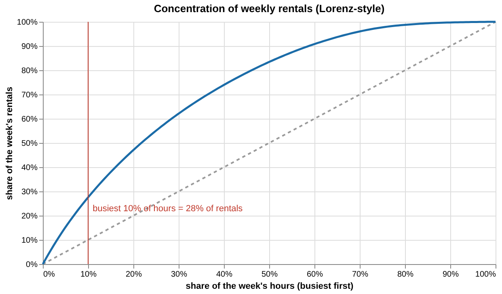

# Decision memo — Fleet or Flow?

*For the CEO. Generated from `artifacts/tables/` on 2026-11-04; every number below comes from the pipeline.*

## Answer
The evidence supports **B (wrong time)**. Demand is sharply peaked in time — the busiest 10% of hours carry 28% of
each week's rentals — and a fleet sized for a 95% service level would still sit idle for 84% of all bike-hours. Occasional
riders, who create the fair-weather leisure peaks, are far more weather-sensitive than members (wet weather leaves 49% of
casual vs 59% of member demand). Both observations the CEO hears — riders find no bike, bikes sit idle — are therefore
explained by **timing (and probably placement)** rather than by a fleet that is too small overall. Our recommendation is not to size the fleet for the maximum: run a service-level fleet of about 702 bikes, invest in rebalancing (worth ≈ 162 bikes), and use the idle night and midday windows for maintenance.
Explanation C (wrong place) cannot be tested with this data; the experiment below settles it. Indirect hint for C: on working days members make 1.55× as many trips in the evening peak (16-19) as in the morning peak (07-09) — commute flows are one-directional by time of day, so bikes pile up downtown in the morning and in residential areas at night. Only station data can confirm it.

## Evidence
1. **Concentration (B).** Half of all rentals happen in 22% of the hours; the weekly peak hour is
   3.4× the average hour. On working days the recommended fleet is at least half in use in only 0 of 24 hours;
   at 03:00 100% of it is idle.
2. **Archetypes.** 2 day shapes: commute (492 days), leisure (236 days). Working days follow a two-peak
   commute shape; non-working days a midday leisure hump with a much higher casual share
   (commute: 13%, leisure: 32%).
3. **Segment weather sensitivity (D).** Pre-registered test: ratio of rate-ratios 0.83 (NB GLM, 95% CI 0.78–0.89)
   and 0.79 (matched wet vs dry, CI 0.70–0.88). Decision: do not reject H0.
4. **Fleet vs flow.** At a 95% service level, poor rebalancing (friction 1.5) needs 810 bikes, good rebalancing (1.2)
   needs 648: **better rebalancing substitutes for ≈ 162 bikes** (20% of the fleet).
5. **Forecast quality.** Champion `catboost_tweedie` — honest peak-window WAPE 12.6%, skill vs seasonal naive
   33% on peaks; conformal intervals within ±3 points of nominal coverage.

## Options

| Option                                                                   | Bikes (estimated)               | Cost (placeholder)                    | Main risk                                                                                  |
|:-------------------------------------------------------------------------|:--------------------------------|:--------------------------------------|:-------------------------------------------------------------------------------------------|
| 1. Buy bikes (size for the 99th-percentile day, today's rebalancing)     | 1,034                           | $1,551/day holding                    | Most bikes idle most hours; does not fix empty docks if the problem is placement           |
| 2. Improve rebalancing (95% service, friction 1.2)                       | 648                             | $1,372/day incl. $400 ops placeholder | Needs trucks/staff or rider incentives; benefit depends on the unmeasured spatial mismatch |
| 3. Service-level fleet (95%, friction 1.3) + maintenance in idle windows | 702                             | $1,053/day holding                    | ≈5% of days some riders find no bike at the busiest hour                                   |
| 4. Do nothing                                                            | current fleet (not in the data) | $0 change                             | Unknown — current fleet size and dock status are not observed                              |

Service-level sensitivity (friction 1.3, trip median 18 min): 90% → 631 bikes, 95% → 702, 99% → 896.
Trip-median sensitivity (95%, friction 1.3): 12 min → 488, 18 min → 702, 25 min → 938.
Cost-optimal service level with the placeholder costs (Cu $3.0, Co $1.5): 67% → 494 bikes.

## Risks and unknowns
- **Censoring.** Recorded rentals are served demand; riders who found no bike left no trace. True peak demand is likely *higher*, so fleet numbers are lower bounds.
  The supply-cap probe found a suggestive truncation signal in best-condition commute hours.
- **No location data.** Station IDs, trips and dock status are missing, so explanation C is untested; the friction factor (1.2–1.5) is an assumption.
- **Trip-duration prior.** Median 18 / p90 45 min is assumed; 12–25 min moves the fleet by
  450 bikes.
- **Data age.** 2011–2012; demand grew 4.5% per month then. Recalibrate on current data before buying anything.

## Next step
1. Run the 8-week **capacity-elasticity switchback** (normal / −10% / +10% bikes by station cluster). MDE ≈ 8.0% of rentals;
   power 98% to detect a 10% effect. No drop when 10% of bikes are withheld → the fleet has slack; gains only in some clusters → placement.
2. Start collecting: trip-level data (start/end station, duration), dock-status snapshots every 5 minutes (zero-bike / zero-dock minutes), rebalancing
   truck logs, and the actual fleet size in service per day.
