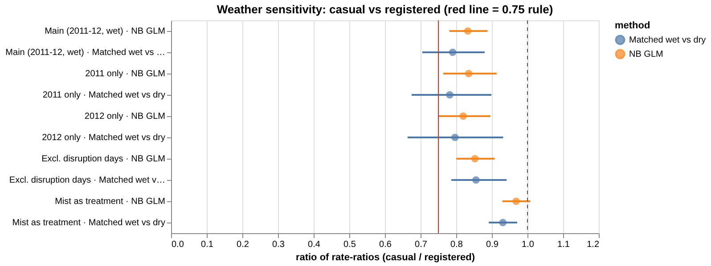
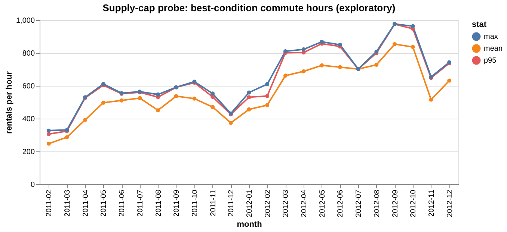

# Hypothesis brief — Workstream 2: who stays home when the weather turns

*Generated from `artifacts/tables/` on 2026-11-04. The pre-registration below was written by code before any estimate existed.*

## 1. Pre-registration (verbatim)

Written by `bikeops.inference.preregister()` on 2026-11-04 07:47, before any model in
Workstream 2 was estimated.

**H1.** Holding hour, calendar class, month and trend fixed, wet weather (weathersit 3, with 4 folded in)
reduces casual rentals by a substantially larger proportion than registered rentals.

**H0.** The wet-weather rate-ratio is the same for both segments.

**Test statistic.** Ratio of rate-ratios, RRR = RR(casual, wet vs dry) / RR(registered, wet vs dry).

**Decision rule.** Reject H0 in favour of H1 only if BOTH
1. the Negative Binomial GLM (date-clustered standard errors) gives RRR < 0.75 with a 95% CI excluding 1, and
2. the matched wet-vs-dry comparison gives RRR < 0.75 with a 95% bootstrap CI (over days) excluding 1.

If only one method meets the rule, the result is reported as *inconclusive*; if neither, H0 is not rejected.
Robustness checks (each year separately, excluding disruption days, mist as a second treatment) are
reported but do not change the decision.

**Why it matters for the CEO.** If the peak that drives fleet size is the fair-weather leisure crowd, bikes bought to serve it sit idle on
every cool or rainy day. The fleet should then be planned on the stable member base plus a service-level allowance.

## 2. Results
| Method | Ratio of rate-ratios (casual / registered) | 95% CI | Wet RR casual | Wet RR registered | Meets rule |
|---|---|---|---|---|---|
| NB GLM, date-clustered SE (n = 34,758 segment-hours, NB α = 0.054) | **0.833** | 0.781–0.888 | 0.488 | 0.587 | no |
| Matched wet vs dry (1,393 wet hours on 294 days, mean gap 2.2 days) | **0.790** | 0.705–0.880 | 0.466 | 0.589 | no |

Wilcoxon signed-rank test on the per-day mean log-ratio difference (matched design): p = 6.9e-11.

**Decision: do not reject H0.** Wet weather cuts casual rentals to 49% of the dry level and registered rentals to
59% (model), i.e. the casual reduction is 51% vs 41% for members.

*Ratio of rate-ratios with 95% CIs, main analysis and robustness checks*

### Model specification
`rentals ~ is_casual × wet + is_casual × temp_c + is_casual × C(hour) × C(calendar_class) + C(month) + growth_index`,
Negative Binomial GLM (α from the Cameron–Trivedi auxiliary regression on a Poisson fit), standard errors clustered by date.
The test statistic is exp(β[is_casual:wet]). Matched design: each wet hour is paired with the 2
nearest dry hours (same hour of day, calendar class, month and year); RRR = (Σ wet / Σ dry)casual / (Σ wet / Σ dry)registered,
with a 2000-replicate bootstrap over days.

## 3. Robustness

| analysis              | method             |   rrr |   ci_low |   ci_high |   p_value |   rr_casual |   rr_registered |
|:----------------------|:-------------------|------:|---------:|----------:|----------:|------------:|----------------:|
| Main (2011-12, wet)   | NB GLM             | 0.833 |    0.781 |     0.888 |     0.000 |       0.488 |           0.587 |
| Main (2011-12, wet)   | Matched wet vs dry | 0.790 |    0.705 |     0.880 |     0.000 |       0.466 |           0.589 |
| 2011 only             | NB GLM             | 0.835 |    0.764 |     0.913 |     0.000 |       0.481 |           0.576 |
| 2011 only             | Matched wet vs dry | 0.782 |    0.675 |     0.899 |     0.000 |       0.461 |           0.590 |
| 2012 only             | NB GLM             | 0.820 |    0.750 |     0.896 |     0.000 |       0.494 |           0.603 |
| 2012 only             | Matched wet vs dry | 0.797 |    0.664 |     0.932 |     0.000 |       0.469 |           0.589 |
| Excl. disruption days | NB GLM             | 0.852 |    0.800 |     0.908 |     0.000 |       0.548 |           0.643 |
| Excl. disruption days | Matched wet vs dry | 0.856 |    0.786 |     0.941 |     0.000 |       0.547 |           0.640 |
| Mist as treatment     | NB GLM             | 0.968 |    0.930 |     1.008 |     0.116 |       0.902 |           0.932 |
| Mist as treatment     | Matched wet vs dry | 0.931 |    0.891 |     0.971 |     0.000 |       0.867 |           0.931 |

## 4. Temperature elasticity (secondary result, 5–25 °C band)

| segment    |   pct_per_degC |   ci_low |   ci_high | band_c   |   n_obs |
|:-----------|---------------:|---------:|----------:|:---------|--------:|
| registered |           3.05 |     2.49 |      3.62 | 5-25     |   22702 |
| casual     |          10.93 |    10.11 |     11.76 | 5-25     |   22702 |

## 5. Supply-cap probe (exploratory — suggestive evidence only)
If the system were bike-constrained, the best-condition peak hours (working-day 08:00 and 17–18:00, clear, 15–28 °C,
humidity < 70%) would pile up just under a ceiling, and residual spread would shrink as predicted demand rises.
329 such hours over 23 months. Median max / p95 ratio per month: 1.01.
Residual coefficient of variation changes by -0.026 per quintile of predicted demand; observed/predicted is
1.13 in the lowest quintile vs 1.02 in the highest.
Truncation signal: **present (suggestive)**.

| bin   |   n |   mean_pred |   mean_obs |   resid_mean |   resid_sd |   resid_cv |   obs_over_pred |
|:------|----:|------------:|-----------:|-------------:|-----------:|-----------:|----------------:|
| Q1    |  66 |         350 |        395 |         45.3 |       76.2 |      0.218 |            1.13 |
| Q2    |  69 |         447 |        461 |         13.3 |       73.7 |      0.165 |            1.03 |
| Q3    |  62 |         526 |        578 |         52.3 |       91   |      0.173 |            1.1  |
| Q4    |  66 |         674 |        696 |         22.2 |       80.6 |      0.12  |            1.03 |
| Q5    |  66 |         784 |        796 |         12.2 |       87.5 |      0.112 |            1.02 |

*Monthly mean / p95 / max of best-condition commute hours*

Monthly table: `artifacts/tables/supply_cap_probe_monthly.csv` (23 months).

## 6. Field experiment to settle what the data cannot
**Capacity-elasticity test.** Switchback design over 8 weeks: each week, matched station clusters are
randomly assigned to (i) normal fleet, (ii) 10% of bikes withheld at the depot, or (iii) 10% extra bikes placed before the AM peak.
Outcomes: rentals per cluster-hour, zero-bike minutes, rentals per bike. If removing 10% of bikes does not reduce rentals, the fleet has
slack and buying more is wasteful; if adding bikes raises rentals only in specific clusters, the problem is placement (explanation C).

**Power.** 30 clusters (assumption), 80 cluster-weeks per arm. AM-peak working-day hours in 2012 average
427 system rentals (≈ 14.2 per cluster-hour); the hourly variance
estimated here implies extra dispersion α = 0.040, and with an assumed 15% cluster-level
noise the cluster-week coefficient of variation is 0.173. **Minimum detectable effect: 8.0%** in rentals
(α = 0.05, power 0.8). Simulated power: 47% for a 5% effect, 98% for a 10% effect.
A fully supply-bound cluster would lose up to 10% of rentals when 10% of bikes are withheld, so the design can detect a binding constraint.

## 7. Limitations
- Observational data: weather is not randomised; controls (hour × day type × segment, month, trend, temperature) reduce but cannot remove confounding.
- Censoring: recorded rentals are *served* demand. If wet hours are less often supply-capped than dry peaks, the true dry-weather demand is higher
  and the casual-vs-member contrast is, if anything, understated for peak hours.
- No location data: the analysis cannot see where riders were turned away (explanation C).
- Hourly weather is a city-wide label; short showers inside an hour are blurred.
