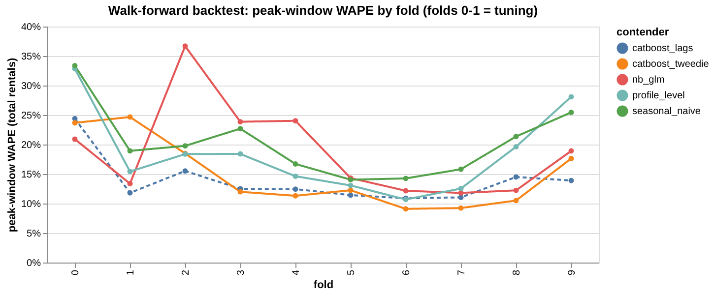
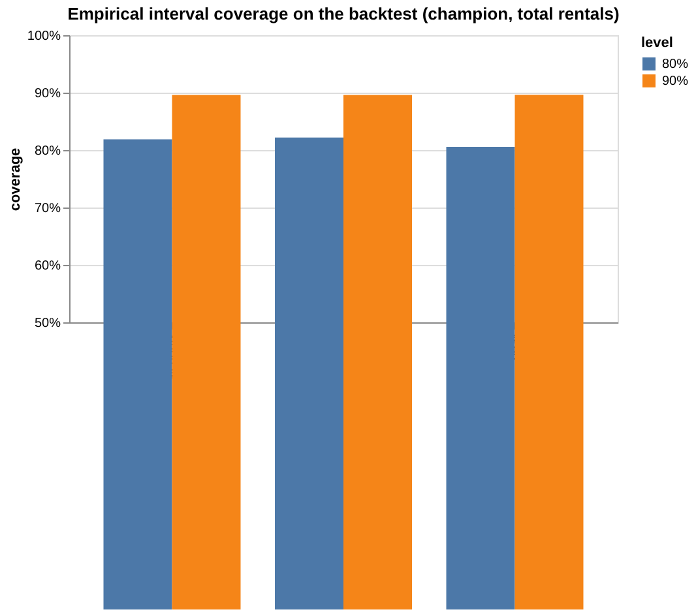
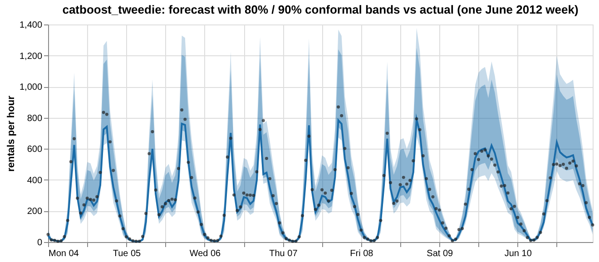
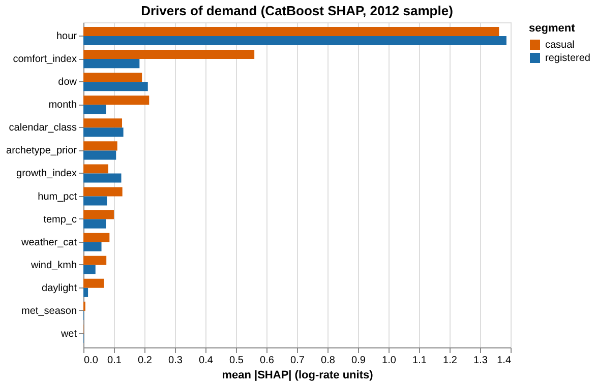
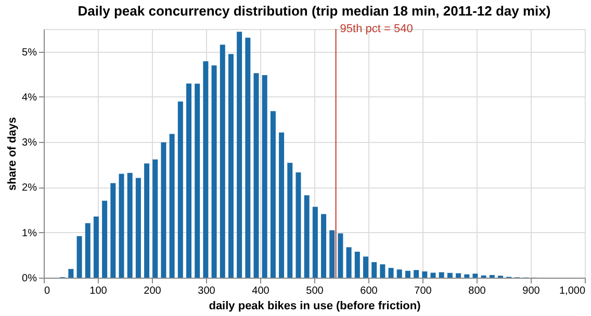
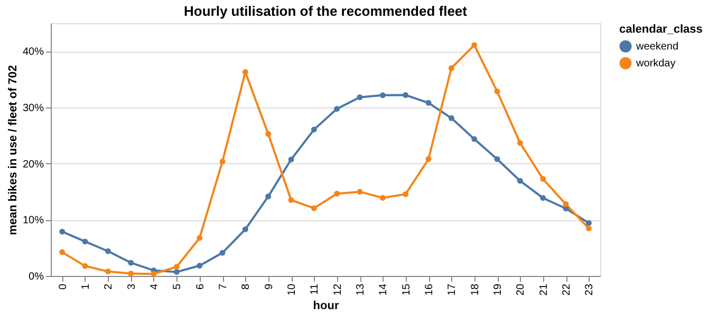

# Model card — demand forecast and fleet sizing (Workstream 3)

*Generated from `artifacts/tables/` on 2026-11-04.*

## Intended use
Hourly forecasts of **served** demand (casual and registered rentals, total = sum) for capacity planning at the system level, and the
derived distribution of bikes on the road. Used to size the fleet and to populate the demand cube behind the operations desk.
Not intended for station-level decisions (no location data) or for live operations without a weather forecast feed.

## Data
Capital Bikeshare, Washington D.C., 2011-01-01 to 2012-12-31 (cleaned per `docs/data_audit.md`; outage hours excluded, night lulls = 0).
Weather inputs are the *observed* hourly weather — in production they must be replaced by forecasts, which will widen errors.

## Validation design
Walk-forward: expanding window, 4-week horizon, 10 folds from 2012-03-01 to 2012-12-31 (last fold runs to year end). Folds 0–1 tune
hyper-parameters; folds 2–9 are the honest score. Two warm-up folds (Jan–Feb 2012) only seed the conformal calibration.
Archetypes, archetype_prior and growth_index are re-derived inside every fold from training days only.

## Contenders and honest scores (folds 2–9, total rentals, observed hours)

| contender        |   wape |   peak_wape |   offpeak_wape |   poisson_dev |    rmse |   pinball_10 |   pinball_50 |   pinball_90 |   cov80 |   cov90 |   skill_vs_naive |   peak_skill_vs_naive |
|:-----------------|-------:|------------:|---------------:|--------------:|--------:|-------------:|-------------:|-------------:|--------:|--------:|-----------------:|----------------------:|
| catboost_lags    |  0.149 |       0.127 |          0.163 |        12.942 |  61.968 |        9.788 |       19.186 |       12.378 |   0.809 |   0.901 |            0.393 |                 0.324 |
| catboost_tweedie |  0.145 |       0.126 |          0.157 |        12.594 |  59.673 |        9.907 |       18.645 |       14.509 |   0.810 |   0.891 |            0.410 |                 0.330 |
| nb_glm           |  0.201 |       0.189 |          0.208 |        18.741 |  81.453 |       12.456 |       25.873 |       15.484 |   0.816 |   0.897 |            0.182 |                -0.003 |
| profile_level    |  0.226 |       0.171 |          0.263 |        29.460 |  96.671 |       17.939 |       29.211 |       16.926 |   0.818 |   0.895 |            0.076 |                 0.091 |
| seasonal_naive   |  0.245 |       0.188 |          0.283 |        47.080 | 109.280 |       16.298 |       31.611 |       35.831 |   0.815 |   0.892 |            0.000 |                 0.000 |

By segment:

| contender        | target     |   wape |   peak_wape |
|:-----------------|:-----------|-------:|------------:|
| catboost_lags    | casual     |  0.246 |       0.227 |
| catboost_lags    | registered |  0.155 |       0.133 |
| catboost_tweedie | casual     |  0.246 |       0.247 |
| catboost_tweedie | registered |  0.151 |       0.130 |
| nb_glm           | casual     |  0.289 |       0.291 |
| nb_glm           | registered |  0.208 |       0.194 |
| profile_level    | casual     |  0.412 |       0.373 |
| profile_level    | registered |  0.211 |       0.168 |
| seasonal_naive   | casual     |  0.439 |       0.373 |
| seasonal_naive   | registered |  0.226 |       0.182 |

**Gradient-boosting backend used for this run: scikit-learn HistGradientBoosting (Poisson) — CatBoost not installed.**

**Champion: `catboost_tweedie`** — lowest peak-window WAPE among the non-diagnostic contenders. Beats every simpler contender on peak
WAPE: seasonal_naive: yes, profile_level: yes, nb_glm: yes. CatBoost settings chosen on the tuning
folds: casual: Poisson, depth 6, registered: Poisson, depth 6. `catboost_lags` is a diagnostic
(1-day-ahead lags) that shows the value of a live data feed; it is not used by the desk.

*Peak-window WAPE by fold and contender*

CatBoost tuning (mean of tuning folds):

| segment    | loss    |   depth |   wape |   poisson_dev |
|:-----------|:--------|--------:|-------:|--------------:|
| casual     | Poisson |       6 | 0.3920 |       15.0683 |
| casual     | Poisson |       8 | 0.4032 |       16.3275 |
| registered | Poisson |       6 | 0.2307 |       17.7054 |
| registered | Poisson |       8 | 0.2394 |       19.1714 |

## Uncertainty
Mondrian split-conformal (hour groups: peak / day / night), implemented with MAPIE `SplitConformalRegressor` on a pass-through estimator whose prediction is the
out-of-sample walk-forward forecast (gamma / relative conformity score on count + 1). Each fold is calibrated only on earlier folds.
Peak coverage off nominal by more than 3 points with the global version: yes → Mondrian used.
All coverages within ±3 points of nominal: **yes**.

| level   | group     |   coverage |   nominal | within_3pts   |   mean_width |
|:--------|:----------|-----------:|----------:|:--------------|-------------:|
| 80%     | all hours |      0.819 |     0.800 | True          |      170.338 |
| 80%     | peak      |      0.806 |     0.800 | True          |      289.695 |
| 80%     | off-peak  |      0.822 |     0.800 | True          |      140.860 |
| 90%     | all hours |      0.896 |     0.900 | True          |      237.436 |
| 90%     | peak      |      0.896 |     0.900 | True          |      395.819 |
| 90%     | off-peak  |      0.896 |     0.900 | True          |      198.321 |

*Empirical coverage of 80% and 90% intervals*

*Champion forecast with conformal bands vs actual*

## Two-level consistency
A daily CatBoost model on day-level features is compared with the sum of hourly forecasts per fold. Reconciliation (scaling hourly shapes
to the daily total) kept: **no** (decided on the tuning folds).

|   fold |   daily_model_wape |   hourly_sum_wape |   disagreement |   wape_base |   wape_reconciled |   peak_wape_base |   peak_wape_reconciled |
|-------:|-------------------:|------------------:|---------------:|------------:|------------------:|-----------------:|-----------------------:|
|  0.000 |              0.203 |             0.242 |          0.100 |       0.261 |             0.226 |            0.237 |                  0.218 |
|  1.000 |              0.329 |             0.211 |          0.210 |       0.236 |             0.339 |            0.247 |                  0.335 |
|  2.000 |              0.110 |             0.121 |          0.103 |       0.163 |             0.152 |            0.185 |                  0.169 |
|  3.000 |              0.094 |             0.074 |          0.077 |       0.120 |             0.137 |            0.120 |                  0.135 |
|  4.000 |              0.090 |             0.080 |          0.079 |       0.135 |             0.141 |            0.113 |                  0.122 |
|  5.000 |              0.095 |             0.086 |          0.058 |       0.128 |             0.131 |            0.123 |                  0.124 |
|  6.000 |              0.071 |             0.064 |          0.069 |       0.122 |             0.126 |            0.091 |                  0.088 |
|  7.000 |              0.079 |             0.065 |          0.082 |       0.114 |             0.127 |            0.092 |                  0.119 |
|  8.000 |              0.119 |             0.072 |          0.111 |       0.124 |             0.168 |            0.105 |                  0.139 |
|  9.000 |              0.219 |             0.175 |          0.115 |       0.230 |             0.277 |            0.176 |                  0.201 |

## Disruption-day sensitivity
Champion WAPE on a subset of honest folds: 13.8% trained with disruption days vs
13.4% without them.

## Drivers (SHAP)

| segment    | feature         |   mean_abs_shap |   rank |
|:-----------|:----------------|----------------:|-------:|
| casual     | hour            |           1.362 |      1 |
| casual     | comfort_index   |           0.560 |      2 |
| casual     | month           |           0.215 |      3 |
| casual     | dow             |           0.192 |      4 |
| casual     | hum_pct         |           0.128 |      5 |
| casual     | calendar_class  |           0.127 |      6 |
| registered | hour            |           1.386 |      1 |
| registered | dow             |           0.211 |      2 |
| registered | comfort_index   |           0.184 |      3 |
| registered | calendar_class  |           0.131 |      4 |
| registered | growth_index    |           0.124 |      5 |
| registered | archetype_prior |           0.107 |      6 |

*Mean |SHAP| by feature and segment*

## From rentals to bikes on the road
Monte Carlo per (month × day type × weather band): N = 2,000 simulated days; hourly rentals drawn from the conformal residual
distribution with a Gaussian copula (intraday correlation ρ = 0.47, estimated from backtest residuals); start minute uniform
within the hour; trip duration LogNormal(median 18 min, p90 45 min) — **the largest assumption in the project**
(sensitivity 12 / 18 / 25 min).

## Fleet sizing
Fleet F(α) = α-quantile of the daily peak concurrency over the 2011–12 day mix × spatial friction.

|   service_level |   trip_median |   peak_concurrency_q |   required_fleet |   idle_share |   missed_rides_per_day |   cost_per_day |
|----------------:|--------------:|---------------------:|-----------------:|-------------:|-----------------------:|---------------:|
|           0.900 |        12.000 |              338.000 |          440.000 |        0.835 |                 27.666 |        742.998 |
|           0.900 |        18.000 |              485.000 |          631.000 |        0.827 |                 26.979 |       1027.437 |
|           0.900 |        25.000 |              648.000 |          843.000 |        0.821 |                 25.674 |       1341.522 |
|           0.950 |        12.000 |              375.000 |          488.000 |        0.851 |                 14.460 |        775.379 |
|           0.950 |        18.000 |              540.000 |          702.000 |        0.845 |                 13.846 |       1094.538 |
|           0.950 |        25.000 |              721.000 |          938.000 |        0.839 |                 13.117 |       1446.351 |
|           0.990 |        12.000 |              479.000 |          623.000 |        0.883 |                  2.379 |        941.637 |
|           0.990 |        18.000 |              689.000 |          896.000 |        0.878 |                  2.287 |       1350.860 |
|           0.990 |        25.000 |              920.000 |         1196.000 |        0.874 |                  2.142 |       1800.426 |

Recommended (95% service, friction 1.3, trip median 18 min): **702 bikes**, idle share of bike-hours
84%.

Newsvendor view (α* = Cu / (Cu + Co), friction 1.3, trip median 18; costs are placeholders):

|    cu |    co |   optimal_service_level |   fleet |   idle_share |
|------:|------:|------------------------:|--------:|-------------:|
| 1.000 | 0.500 |                   0.667 | 494.000 |        0.779 |
| 1.000 | 1.000 |                   0.500 | 429.000 |        0.746 |
| 1.000 | 1.500 |                   0.400 | 388.000 |        0.719 |
| 1.000 | 2.000 |                   0.333 | 358.000 |        0.695 |
| 1.000 | 3.000 |                   0.250 | 315.000 |        0.654 |
| 2.000 | 0.500 |                   0.800 | 556.000 |        0.804 |
| 2.000 | 1.000 |                   0.667 | 494.000 |        0.779 |
| 2.000 | 1.500 |                   0.571 | 458.000 |        0.762 |
| 2.000 | 2.000 |                   0.500 | 429.000 |        0.746 |
| 2.000 | 3.000 |                   0.400 | 388.000 |        0.719 |
| 3.000 | 0.500 |                   0.857 | 592.000 |        0.816 |
| 3.000 | 1.000 |                   0.750 | 530.000 |        0.794 |
| 3.000 | 1.500 |                   0.667 | 494.000 |        0.779 |
| 3.000 | 2.000 |                   0.600 | 468.000 |        0.767 |
| 3.000 | 3.000 |                   0.500 | 429.000 |        0.746 |
| 5.000 | 0.500 |                   0.909 | 641.000 |        0.830 |
| 5.000 | 1.000 |                   0.833 | 575.000 |        0.810 |
| 5.000 | 1.500 |                   0.769 | 540.000 |        0.798 |
| 5.000 | 2.000 |                   0.714 | 514.000 |        0.788 |
| 5.000 | 3.000 |                   0.625 | 479.000 |        0.772 |
| 8.000 | 0.500 |                   0.941 | 687.000 |        0.841 |
| 8.000 | 1.000 |                   0.889 | 619.000 |        0.824 |
| 8.000 | 1.500 |                   0.842 | 582.000 |        0.813 |
| 8.000 | 2.000 |                   0.800 | 556.000 |        0.804 |
| 8.000 | 3.000 |                   0.727 | 520.000 |        0.790 |

Fleet vs flow (95% service): poor (1.5) vs good (1.2) rebalancing.

|   trip_median |   fleet_poor_rebalancing |   fleet_good_rebalancing |   bikes_saved_by_rebalancing |   pct_saved |
|--------------:|-------------------------:|-------------------------:|-----------------------------:|------------:|
|        12.000 |                  563.000 |                  450.000 |                      113.000 |       0.201 |
|        18.000 |                  810.000 |                  648.000 |                      162.000 |       0.200 |
|        25.000 |                 1082.000 |                  866.000 |                      216.000 |       0.200 |

*Distribution of daily peak bikes in use*

*Hourly utilisation of the recommended fleet*

## Limitations and assumptions
- Served demand only: forecasts and fleet numbers inherit the censoring bias — true peak demand is likely **higher**, so the fleet numbers are a lower bound on what full demand would need.
- Trip-duration prior (no trip data), spatial friction factor (no dock data) and cost placeholders drive the fleet numbers; all are in `config.yaml`.
- Demand level frozen at 2012; 2011–12 data are old — growth since then is not modelled.
- Weather inputs are observed, not forecast.
